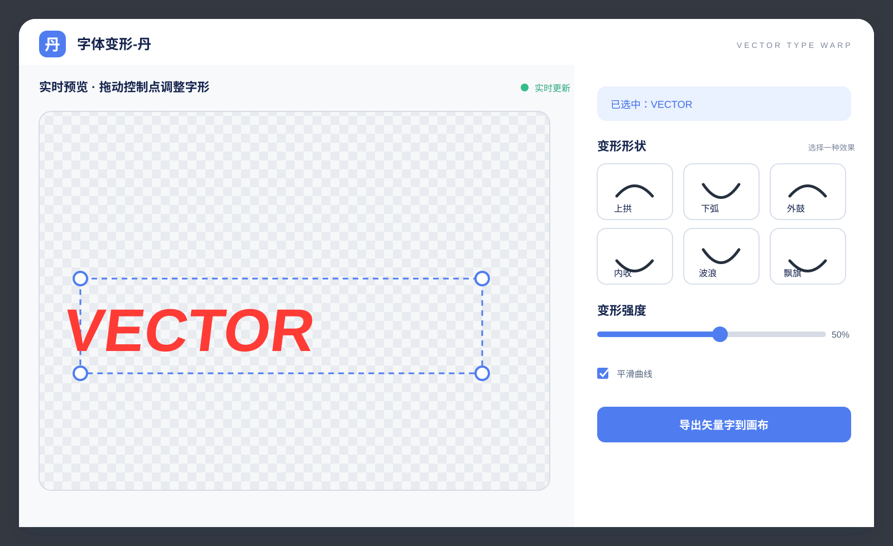

# 字体变形-丹

 

一个用于 Figma 的文字转矢量与字体变形插件。选中文字后，可以实时预览变形效果，并将结果导出为可继续编辑的矢量图层。

## 功能亮点

- 8 种预设变形：上拱、下弧、外鼓、内收、波浪、飘旗、斜切、透视。
- 自定义曲线：拖动 5 个控制点编辑字形起伏。
- 预览区四角手柄可继续自由调整字形。
- 支持强度、曲线平滑、描边宽度和描边颜色。
- 导出结果放在原文字右侧，生成独立、可继续编辑的矢量图层。
- 支持普通页面、Frame 和自动布局 Frame。
- 原文字默认保留，也可以选择导出后隐藏。

## 功能预览

## 快速安装

1. 下载本项目的 [v5.2.0 Release](https://github.com/wangmeili890422-jpg/figma-type-warp-dan/releases/tag/v5.2.0)，或下载 [main 分支 ZIP](https://github.com/wangmeili890422-jpg/figma-type-warp-dan/archive/refs/heads/main.zip)。
2. 解压文件。
3. 使用 Figma 桌面端打开一个可编辑的 Design 文件。
4. 打开 Plugins → Development → Import plugin from manifest…。
5. 选择解压目录中的 manifest.json。
6. 选中一个文字图层，运行“字体变形-丹”。

完整图文说明：

- [在线安装说明](https://wangmeili890422-jpg.github.io/figma-type-warp-dan/install-guide.html)
- [项目内安装说明](install-guide.html)

## 当前限制

- 一次处理一个普通文字图层。
- 组件实例内部的文字暂不支持，请先复制到普通画布。
- 这是开发版插件，需要通过 Figma 的 Development 菜单加载。
- manifest 中的插件 ID 是本地开发占位值，不代表已发布到 Figma Community。

## 本地检查

项目不依赖第三方 npm 包，可以运行：

~~~bash
npm run check
npm test
~~~

当前测试脚本包含 code.js 基础语法检查；正式功能仍需在 Figma 桌面端完成一次真实导出验证。

## 参与贡献

欢迎提交 Issue 和 Pull Request。提交前请阅读 [CONTRIBUTING.md](CONTRIBUTING.md)。

## 开源协议

本项目采用 MIT License，详见 [LICENSE](LICENSE)。
